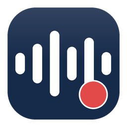

# xgb_wav · 工业音频坏件检测

XGBoost + wav2vec2 双模型融合的 wav 坏件检测**桌面应用**（Windows / macOS / Linux）。
纯本地运行、**完全离线**，不依赖网络与云端。



## 安装（Windows，推荐）

1. 下载 `xgb_wav_Setup_1.0.0.exe`
2. 双击安装（默认装到 `%LOCALAPPDATA%\Programs\xgb_wav`，**无需管理员权限**）
3. 开始菜单 / 桌面快捷方式启动

卸载：设置 → 应用 → xgb_wav。

## 从源码运行

```bash
# 需要 Python 3.12 或 3.13（64 位）
python -m pip install -r requirements.txt
python main.py            # 打开图形界面
```

## 界面用法

| 区域 | 说明 |
|---|---|
| 模型目录 | 默认 `./models`，随程序分发 |
| 输入 | 选择一批 wav 文件或整个文件夹 |
| **判定阈值** | 滑块 / 输入框，**实时重判**（不重新推理），自动保存到 `settings.json` |
| 开始检测 | 显示进度；完成后表格按 bad（红）/ good（绿）着色 |
| 导出 CSV | 按**当前阈值**导出，UTF-8-BOM，Excel 直接可读 |

## 阈值怎么调（误杀率偏高时）

融合分与判定规则：

```
score = mean( (logit(p_xgb) - mu_xgb)/sd_xgb , (logit(p_w2v) - mu_w2v)/sd_w2v )
bad  <=>  score >= threshold
```

- **调高阈值**：误杀↓、漏检↑（保守）
- **调低阈值**：漏检↓、误杀↑（激进）
- 默认 `0.3135`（训练时标定：留出集召回 100%、误杀 1.7%）

真实产线误杀偏高时：把阈值从 0.31 往上拖（如 0.5 / 0.6），
表格里 bad/good 数量会**实时**变化，选一个可接受的点再「导出 CSV」。
设置写入程序目录的 `settings.json`，下次启动自动沿用；「恢复模型默认」可还原。

## 命令行

```bash
python -m xgb_wav.cli --models models --input D:\wavs --output result.csv
python -m xgb_wav.cli --input D:\wavs --output result.csv --threshold 0.6 --save-threshold
```

## 目录结构（运行时最小集）

```
xgb_wav/
├── main.py                 应用入口
├── src/xgb_wav/            核心代码（音频 / 特征 / 两路模型 / 融合 / 界面）
├── models/                 模型与配置（detector.json 为入口）
├── assets/app.ico          图标
├── requirements.txt
├── VERSION
└── LICENSE
```

构建 / 训练 / 测试 / 打包脚本单独放在发布包的 `tools/` 目录（与 `xgb_wav/` 同级），
本仓库只包含运行集。

## 模型与指标

| 项目 | 值 |
|---|---|
| 融合方式 | 两路 logit 标准化后取均值 |
| 默认阈值 | 0.3135（margin 0.2） |
| 留出集（204 条） | 召回 **1.0000**、精度 0.9118、误杀 3/173（1.7%）、AUC 0.9983 |

`models/detector.json` 指明各文件；`xgb_model.ubj` + `xgb_scaler.json` 为可移植格式
（跨平台加载稳定），`xgb_pipeline.joblib` 仅作兼容回退。

## 许可

MIT
